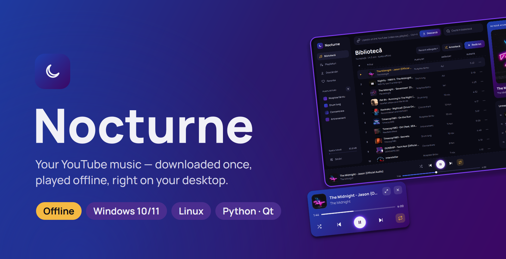
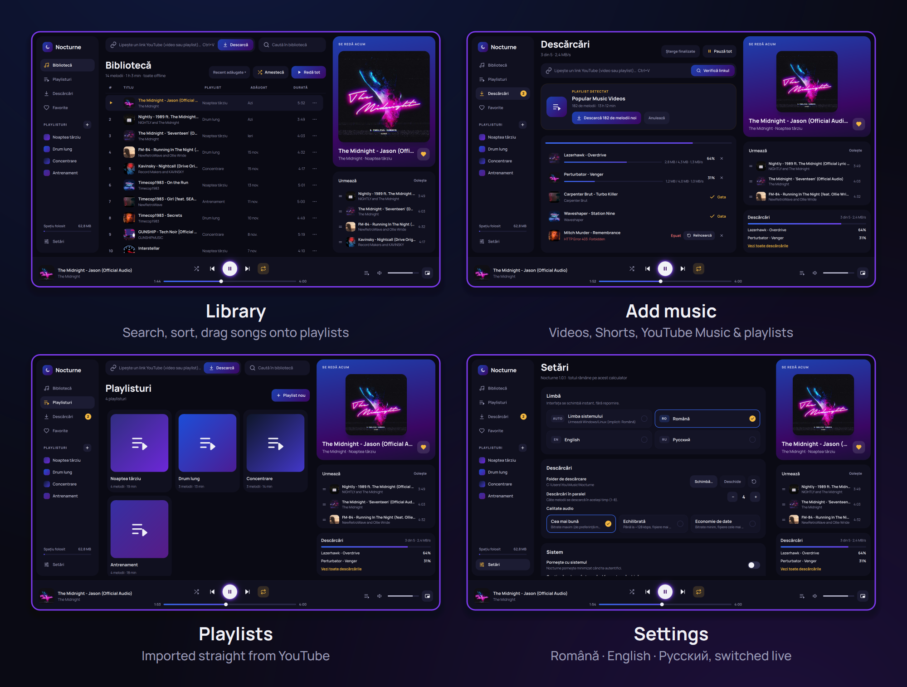
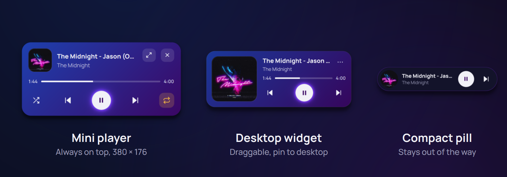

<div align="center">



<br>

<a href="https://github.com/cr37u/nocturne-desktop/releases/latest"></a>
&nbsp;

&nbsp;

&nbsp;

&nbsp;
<a href="LICENSE"></a>

<br><br>

**Paste a YouTube link. Nocturne downloads the audio once and plays it offline, from the tray,**<br>
**the media keys, the lock screen or a desktop widget. No account, no API key, no servers.**

<br>

<a href="https://github.com/cr37u/nocturne"></a>

</div>

<br>

<p align="center">
  
</p>

## Highlights

<table>
<tr>
<td width="50%" valign="top">

### Add anything from YouTube
Single videos, Shorts, YouTube Music links and whole playlists (every item).
Press **Ctrl+V** anywhere in the window, paste into the link field, or drag a link
from your browser. A YouTube playlist becomes a local playlist automatically.

</td>
<td width="50%" valign="top">

### Fast, parallel downloads
Best audio-only stream (m4a/AAC preferred, no FFmpeg needed), 1–8 tracks in
parallel, per-track progress and speed, three retries, duplicates skipped, pause and
resume. Progress also shows on the taskbar icon.

</td>
</tr>
<tr>
<td width="50%" valign="top">

### Feels like part of the system
Windows: media flyout and lock screen (SMTC), media keys, previous / play-pause / next
on the taskbar thumbnail, toast when a playlist finishes. Linux: MPRIS2 for GNOME and
KDE media controls. Closing the window keeps the music playing in the tray.

</td>
<td width="50%" valign="top">

### Widgets everywhere
A frameless desktop widget (large card or compact pill), an always-on-top mini
player, a **Windows 11 Widgets board** card (Win+W), a KDE Plasma widget and a GNOME
Shell extension.

</td>
</tr>
<tr>
<td width="50%" valign="top">

### Your library, organised
Search, sort, favorites, playlists with drag & drop, a reorderable queue, shuffle and
repeat (off / all / one). Queue, track and position are restored after a restart.

</td>
<td width="50%" valign="top">

### Română · English · Русский
Switch the language live, no restart: the window, tray menu, widgets, notifications
and Win+W cards all update at once. Plurals, dates and sizes follow the language.

</td>
</tr>
</table>

<p align="center">
  
</p>

## Download

Grab the latest build from [Releases](https://github.com/cr37u/nocturne-desktop/releases/latest):

| File | For |
|---|---|
| **`nocturne-desktop-vX.Y.Z-setup.exe`** | Windows 10/11 installer. Start menu, optional desktop shortcut and "start with Windows". No admin rights needed. |
| **`nocturne-desktop-vX.Y.Z-portable.zip`** | Windows, no install: unzip anywhere and run `Nocturne.exe`. |
| **`nocturne-desktop-vX.Y.Z.msix`** | Windows 11 full edition, adds the **Win+W Widgets board** card. Needs the certificate below. |
| **`nocturne-desktop-vX.Y.Z-x86_64.AppImage`** | Any Linux distribution: `chmod +x` and run. Needs `libfuse2` (or `--appimage-extract-and-run`). |

<details>
<summary><b>Installing the MSIX (Win+W widget edition)</b></summary>
<br>

The MSIX is signed with a free self-signed certificate, so Windows has to trust it once:

1. Download `nocturne-desktop-certificate.cer` from the same release, double-click it → **Install Certificate** →
   **Local Machine** → *Place all certificates in the following store* → **Trusted People**.
2. Double-click the `.msix` → **Install**.
3. Start Nocturne once, then press **Win+W** → **+** → **Nocturne** → **Pin**.
   If it doesn't show up, sign out and back in once.

```
Subject  CN=Nocturne Dev
SHA-256  81:89:de:94:c3:5c:6e:3f:dd:20:06:42:e4:f1:1f:7e:f5:4f:bb:38:21:f4:ff:34:2f:dc:65:31:76:fd:2d:35
```

Use only one Windows edition at a time (installer **or** MSIX).

</details>

> [!TIP]
> Install **Node.js** or **Deno** if you have it handy. YouTube increasingly needs a JavaScript runtime for some
> formats; Nocturne passes it to yt-dlp automatically. When downloads suddenly fail, open
> **Setări → yt-dlp → Caută actualizări**: the extractor updates itself without reinstalling the app.

The interface is in Romanian by default; English and Russian are one click away in **Setări → Limbă**.

## Nocturne on your phone

The same player exists for **Android**: same design, same YouTube links, everything offline, with background playback and
lock-screen controls. Get it from [cr37u/nocturne](https://github.com/cr37u/nocturne) →
[latest APK](https://github.com/cr37u/nocturne/releases/latest). You can also open it from **Setări → Despre → Nocturne pentru Android**.

## Under the hood

| | |
|---|---|
| **UI** | Python 3.12, PySide6 (Qt 6) + Qt Quick / QML, Manrope |
| **Playback** | QtMultimedia `QMediaPlayer` (FFmpeg backend: m4a/AAC, webm/opus) |
| **Extraction** | [yt-dlp](https://github.com/yt-dlp/yt-dlp) as a library (+ EJS), self-updating from the app |
| **Storage** | SQLite; audio in `Music/Nocturne` |
| **Windows** | SMTC via WinRT, `ITaskbarList3`, toasts, StartupTask / Run key |
| **Linux** | MPRIS2 + notifications over D-Bus, XDG autostart |
| **Win+W widget** | C# .NET 8 `IWidgetProvider` (Windows App SDK) talking to the app over `\\.\pipe\nocturne` |
| **Packaging** | PyInstaller, Inno Setup, MSIX, AppImage, Flatpak manifest |

<details>
<summary><b>Project layout</b></summary>
<br>

```
nocturne/
├── app.py  app_controller.py   start-up, QML engine, tray, OS integration
├── player.py  downloader.py    playback queue · parallel yt-dlp downloads
├── db.py  settings.py  i18n.py  models.py  links.py  ytdlp_update.py
├── platform/                   windows.py · linux.py · widget_ipc.py (named pipe)
├── qml/Nocturne/               the whole UI (Theme.qml holds every design token)
└── i18n/                       nocturne_{ro,en,ru}.ts / .qm
widget-bridge/                  Windows 11 Widgets board provider (C#)
packaging/                      PyInstaller specs, Inno Setup, MSIX, AppImage, Flatpak,
                                KDE plasmoid, GNOME Shell extension
tools/                          asset generator, translation tool
```

</details>

## Building from source

You need Python 3.12. Everything else is pinned in `requirements.txt`.

```bash
git clone https://github.com/cr37u/nocturne-desktop.git && cd nocturne-desktop
python3.12 -m venv .venv && .venv/bin/pip install -r requirements.txt   # Windows: .venv\Scripts\pip
python tools/i18n_tool.py release      # compile translations
python -m nocturne
```

<details>
<summary><b>Windows installer, portable zip and MSIX</b></summary>
<br>

```powershell
powershell -ExecutionPolicy Bypass -File packaging\build_windows.ps1        # needs Inno Setup 6
powershell -ExecutionPolicy Bypass -File packaging\msix\build_msix.ps1      # + .NET 8 SDK; creates/trusts the cert, installs
```

</details>

<details>
<summary><b>Linux AppImage (runs on any distribution)</b></summary>
<br>

Build on an old glibc so the result runs everywhere:

```bash
docker run --rm -v "$PWD":/src -w /src ubuntu:22.04 bash packaging/build_linux.sh
```

KDE widget: `kpackagetool6 -t Plasma/Applet -i packaging/plasmoid/io.github.nocturne.widget`
(or **Setări → Instalează widgetul KDE**). GNOME: copy `packaging/gnome-extension/nocturne@nocturne` to
`~/.local/share/gnome-shell/extensions/` and enable it.

</details>

Detailed documentation (in Romanian), including the full test checklist: [docs/README.ro.md](docs/README.ro.md).

## Disclaimer

Nocturne isn't affiliated with YouTube or Google. Only download content you have the right to download,
and respect YouTube's Terms of Service and the copyright laws where you live.

## License

Released under the [GNU General Public License v3.0](LICENSE).
Nocturne uses [yt-dlp](https://github.com/yt-dlp/yt-dlp) (Unlicense), [PySide6 / Qt](https://www.qt.io/qt-for-python) (LGPL-3.0)
and the [Manrope](https://github.com/sharanda/manrope) typeface (SIL OFL 1.1).
